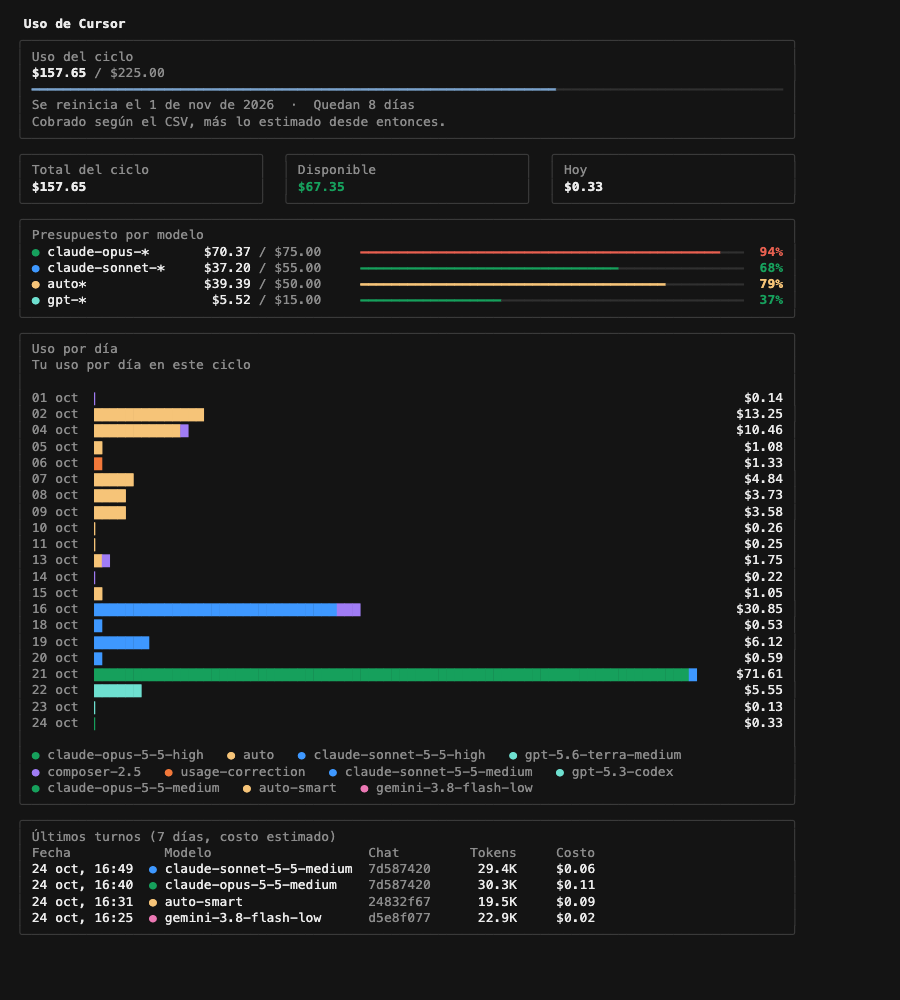

# cursor-budget

Dos hooks globales de Cursor que cuidan el gasto:

- **`stop`**: estima el costo de cada turno, lo anota en `~/.cursor/budget/ledger.jsonl` y avisa con una
  notificación de macOS la primera vez que un chat o el día pasa un límite.
- **`beforeSubmitPrompt`**: bloquea el prompt antes de que llegue al modelo, con costo cero, si el modelo está en la
  lista de bloqueados o si el chat o el día ya gastaron su límite de bloqueo.

## Instalar

Una línea, con [gh](https://cli.github.com) con la sesión iniciada (`brew install gh && gh auth login`):

```bash
gh api repos/josefigueredo/cursor-budget/contents/bootstrap.sh -H "Accept: application/vnd.github.raw" | bash
```

El repo es interno: un `curl` sin autenticación recibe 404, por eso la línea usa `gh`. `bootstrap.sh` clona el repo
en una carpeta temporal, corre `install.sh` y la borra. Para actualizar, corré la misma línea.

Con el repo ya clonado:

```bash
./install.sh
```

Copia el programa a `~/.cursor/budget/app` (su propia carpeta, junto al registro y la configuración), apunta los
hooks de Cursor a esa copia y agrega `alias cbudget=...` a `~/.zshrc` (o `~/.bashrc`). Así los hooks siguen andando
aunque este repo se mueva o cambie de rama. Volver a correrlo actualiza la copia sin tocar `config.json`,
`ledger.jsonl` ni `baseline.json`. El hook y el alias usan el `python3` con el que se instaló, con ruta absoluta,
porque Cursor no siempre hereda el PATH de la terminal: si actualizás Python a otra versión menor, volvé a instalar.

## Comandos

```bash
cbudget install-hook         # lo suma a ~/.cursor/hooks.json sin tocar los demás (deja un .bak)
cbudget limits                      # límites vigentes, gasto contra presupuesto por modelo y chequeo de coherencia
cbudget limits check                # solo los problemas (exit 1 si hay un error)
cbudget limits edit                 # editor interactivo, solo en terminal
cbudget limits set block_day 12     # cambia un límite general (también 80%, si/no)
cbudget limits model 'claude-sonnet-*' 70   # presupuesto del ciclo para un modelo (--remove lo quita)
cbudget limits block 'claude-opus-*'        # bloquea un patrón (unblock lo libera)
cbudget alias                # agrega o actualiza el alias en el rc de la shell
cbudget report --days 7      # ciclo, presupuestos y gasto por día, modelo y chat (en color; --color never o NO_COLOR para texto plano)
cbudget allow --minutes 30   # levanta los bloqueos un rato
cbudget calibrate usage.csv  # cobrado contra estimado por modelo, desde el CSV del dashboard
cbudget seed usage.csv       # toma lo cobrado este ciclo como base del total del ciclo (o --amount 157.21)
```



Captura de la salida real de `cbudget report` en color, pasada a HTML (2026-10-24).

## Límites por defecto

| Clave | Valor | Qué hace |
|---|---|---|
| `warn_conversation` | $2 | avisa: "abrí un chat nuevo" |
| `block_conversation` | $5 | bloquea los prompts siguientes de ese chat |
| `warn_day` | $8 | avisa |
| `block_day` | $15 | bloquea hasta mañana o hasta `allow` |
| `cycle_day` / `cycle_limit` | 1 / $225 | día en que se reinicia el ciclo y tope del plan |
| `cycle_warn` | 75%, 90%, 100% | avisa al cruzar esas partes del tope |
| `notify_each_turn` | sí | después de cada turno: costo del turno, del chat y del ciclo |
| `model_budgets` | ninguno | presupuesto del ciclo por patrón de modelo, p. ej. `{"claude-opus-*": 75}`: avisa al 80% (`model_warn`) y bloquea ese modelo al agotarlo |
| `blocked_models` | `claude-opus-*-high`, `*-xhigh`, `*-max` | bloquea esos modelos |

Para cambiarlos, escribí solo las claves que quieras en `~/.cursor/budget/config.json`. Los precios están en
`cbudget/prices.json`; una copia en `~/.cursor/budget/prices.json` tiene prioridad.

## Lo medido (2026-10-24, cursor-agent 2026.10.22)

- El payload de `stop` trae `model`, `conversation_id`, `input_tokens`, `output_tokens`, `cache_read_tokens` y
  `cache_write_tokens`, por turno, no acumulado. `input_tokens` incluye los tokens de caché: un segundo turno
  dio 22934 de entrada con 19807 de lectura de caché.
- `beforeSubmitPrompt` trae `model` y `conversation_id`. Responder `{"continue": false}` **bloquea en `cursor-agent`**:
  no hubo respuesta ni evento `stop`. El `user_message` no se ve en la terminal, por eso además sale una notificación.
  **En el IDE también bloquea** (Cursor 2026.10.22, probado el 2026-10-24): muestra "Submission blocked by hook" con el
  `user_message` y el prompt no llega al modelo.
- La fórmula (precio de API, más 1.25x en la escritura de caché, más $0.25 por millón en modelos de terceros)
  reproduce la factura del 21 de octubre ($70.26 de Opus) con un error de ±5%. Hay un test que lo controla.
  Un turno de Gemini Flash dio $0.017 estimado, contra $0.02 en el CSV.

Cada bloqueo queda anotado en `~/.cursor/budget/blocks.jsonl`. Sirve de prueba de que el hook frenó, aunque
el IDE no muestre el mensaje.

## Gasto del ciclo

Sin CSV: mirá en cursor.com/dashboard → Usage el monto de "Your monthly usage" (el primero de "$157.21 / $225") y
corré `cbudget seed --amount 157.21`. Es la vía para quien no exporta archivos; no trae el detalle por modelo ni por
día, así que los presupuestos por modelo cuentan desde ese momento. Si instalás el día que arranca el ciclo, no
hace falta ningún seed: el registro ve el ciclo entero.

El hook no puede preguntarle a Cursor cuánto llevás: suma lo que ve. `cbudget seed <csv>` guarda lo que Cursor cobró
este ciclo según el CSV y, a partir del último evento del CSV, el hook suma sus estimaciones. Sin `seed`, el total
del ciclo cuenta solo desde la instalación y el aviso lo dice. Un turno que termina justo después del último evento
del CSV puede contarse dos veces (centavos).

## Terminal y chat: un solo CLI

En la terminal, `cbudget limits edit` pregunta límite por límite (Enter deja el actual), muestra los cambios y el
chequeo, y guarda solo si confirmás. Desde un chat de Cursor, Claude Code o Codex, la skill `cursor-budget`
(`SKILL.md`, la instala `install.sh`) le dice al agente qué subcomando no interactivo correr. La skill solo cambia un
límite si se lo pediste en ese chat; igual, cada cambio queda en `~/.cursor/budget/changes.jsonl` con quién lo hizo
(`terminal` o `agente`) y sale una notificación, porque un agente podría subirse su propio presupuesto.

## Presupuesto por modelo

`model_budgets` en `~/.cursor/budget/config.json` asigna un tope del ciclo a cada patrón (`fnmatch`; gana el primero
que coincide, en el orden escrito). Lo gastado sale de `seed` (por modelo) más las estimaciones posteriores. Las filas
del CSV que Auto derivó (`grok-4.7-high (Auto Balanced)`) cuentan para `auto*`, porque el hook solo ve `auto-smart`.
`cbudget report` muestra cuánto le queda a cada uno.

## Calibrar

Exportá el CSV en el dashboard de Cursor (Usage → Export) y corré `cbudget calibrate <csv>`. Marca con
`<- ajustar` los modelos con más de 10% de error y los que no coinciden con ningún precio. Con el CSV de octubre de
2026 dio $161.92 estimado contra $156.34 cobrado (+4%).

## Límites conocidos

- **Auto**: el payload dice `auto-smart` (el modo), nunca el modelo al que Auto derivó. Desde agosto de 2026 Auto cobra
  el precio de lista de ese modelo, así que el costo de Auto es una estimación a precio de Sonnet 5.5. Auto no se bloquea.
- El registro empieza a contar el día que lo instalás: no conoce el gasto anterior. El tope real del mes lo pone Cursor.
- Si el hook falla, deja pasar el prompt (falla abierto) para no romper Cursor.
- Los precios marcados `estimate` en `prices.json` no están verificados.

## Desarrollar

`python3 -m unittest discover -s tests`, también con `/usr/bin/python3` (3.9). Solo biblioteca estándar. Conventional commits.
