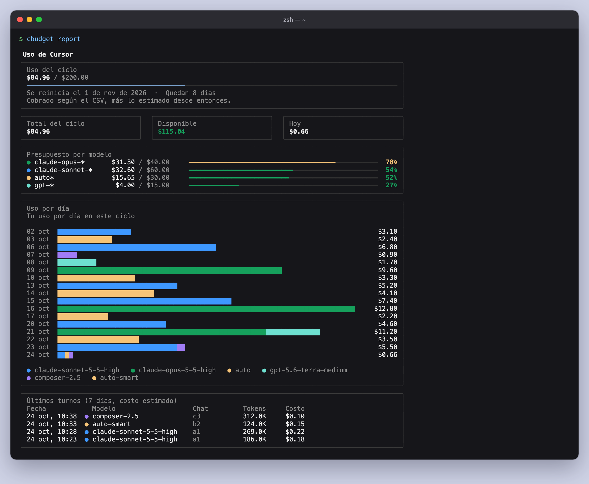

# cursor-budget

Un freno de gasto para Cursor: dos hooks globales y un CLI chico (`cbudget`), con una skill para manejarlo desde el chat.
Después de cada turno estima cuánto costó y te avisa con una notificación de macOS cuando un chat, el día, el ciclo o un
modelo pasan su límite. Antes de cada prompt, si ya llegaste al límite de bloqueo o el modelo está bloqueado, lo frena
sin que llegue al modelo, con costo cero.

| Le decís al agente… | Y la skill… |
|---|---|
| *«¿Cuánto llevo gastado en Cursor y cómo están mis límites?»* | corre `cbudget report` y `cbudget limits` y te contesta con el ciclo, lo que queda, el gasto por modelo y los límites activos |
| *«Bajá el tope diario a 12»* | `cbudget limits set block_day 12`, después `cbudget limits check`, y te dice el valor anterior y el nuevo |
| *«Poné un presupuesto de 40 dólares para Opus en este ciclo»* | `cbudget limits model 'claude-opus-*' 40`: avisa al 80% y bloquea Opus al agotarlo |
| *«Bloqueá GPT»* / *«Desbloqueá Opus High»* | `cbudget limits block 'gpt-*'` / `cbudget limits unblock 'claude-opus-*-high'` |
| *«Levantá el bloqueo media hora»* | `cbudget allow --minutes 30`, solo porque se lo pediste |
| *«Cargá el CSV de uso que bajé de Cursor: ~/Downloads/team-usage-events….csv»* | `cbudget seed <csv>`, una sola vez al instalar: desde ahí el total del ciclo es el de Cursor más lo que ven los hooks |

**La skill nunca sube un límite, desbloquea ni corre `allow` por su cuenta**, aunque un bloqueo le corte la tarea. Cada
cambio queda anotado con quién lo hizo y sale una notificación. Lo que no puede ver está en
[qué te protege y qué no](docs/showcase.md#qué-te-protege-y-qué-no).

## Elegí por dónde empezar

| Componente | Qué resuelve | Escribe | Se instala con | Showcase | Instalación |
|---|---|---|---|---|---|
| **Hook `stop`** | Saber cuánto costó cada turno y enterarte cuando un chat, el día o el ciclo pasan su límite | `~/.cursor/budget/ledger.jsonl` | `install.sh` | [Ver el caso](docs/showcase.md#1-ver-cuánto-llevás) | [Instalar](docs/instalacion.md#1-instalar) |
| **Hook `beforeSubmitPrompt`** | Frenar un prompt antes de que cueste: modelo bloqueado, presupuesto agotado, chat o día en su tope | `~/.cursor/budget/blocks.jsonl` | `install.sh` | [Ver el caso](docs/showcase.md#4-cuando-te-frena) | [Instalar](docs/instalacion.md#6-cuando-te-frena) |
| **Skill `cursor-budget`** | Ver el gasto y cambiar los límites conversando, desde Cursor, Claude Code o Codex | `~/.cursor/budget/config.json` y `changes.jsonl` | `install.sh` | [Ver el caso](docs/showcase.md#2-cambiar-un-límite-desde-el-chat) | [Instalar](docs/instalacion.md#5-cambiar-un-límite) |
| **`cbudget` en la terminal** | El reporte con colores y el editor interactivo de límites | `~/.cursor/budget/config.json` y `changes.jsonl` | `install.sh` (alias) | [Ver el caso](docs/showcase.md#3-el-reporte-y-el-editor-en-la-terminal) | [Instalar](docs/instalacion.md#4-preguntar-cuánto-llevás) |

## Un ejemplo: el reporte

`cbudget report` en la terminal, con el mismo aspecto que la página de uso de Cursor: el ciclo, lo disponible, el
presupuesto de cada modelo y el gasto por día. El recorrido completo está en el
[showcase](docs/showcase.md#3-el-reporte-y-el-editor-en-la-terminal).



*Salida real del `cbudget` actual con datos inventados (un ciclo de ejemplo de $85 sobre $200), no el gasto de nadie.*

## Qué documento leer

| Si querés… | Leé | Qué encontrás |
|---|---|---|
| **Instalarlo y usarlo, conversando con tu agente** | [Instalación y primer uso](docs/instalacion.md) | Todo con prompts: instalar, comprobar las notificaciones, cargar lo gastado, preguntar, cambiar límites y qué hacer cuando te frena |
| **Instalarlo comando por comando** | [Instalación detallada](docs/instalacion-detallada.md) | Requisitos, las formas de instalar, qué deja instalado, los comandos de uso y cómo desinstalar, con capturas de la terminal |
| **Ver todo lo que hace** | [Showcase](docs/showcase.md) | Cada caso: qué le decís al agente, qué corre, qué ves y qué pasa si algo falla |
| **Verla en el taller de skills** | [Episodio del taller](https://probable-dollop-lk5vvym.pages.github.io/) | El episodio que se dio en el taller de team, publicado en GitHub Pages (sitio privado: entrás con tu cuenta de la organización). El guion vive en [`workshop/`](workshop/) |
| **Consultar los detalles** | [Referencia](docs/referencia.md) | Cada comando, los límites por defecto, los archivos, cómo estima el costo, lo medido y los códigos de salida |

## En tres comandos

```bash
gh api repos/josefigueredo/cursor-budget/contents/bootstrap.sh -H "Accept: application/vnd.github.raw" | bash
cbudget seed ~/Downloads/team-usage-events*.csv   # en una terminal nueva, una vez: el CSV de cursor.com/dashboard/usage (MTD, Export CSV)
cbudget report
```

Requisitos: macOS, Cursor, el `python3` de macOS (`/usr/bin/python3`, viene con las Command Line Tools: `xcode-select --install`) y [gh](https://cli.github.com) con la sesión
iniciada, porque el repo es interno y un `curl` sin autenticación recibe 404. Los datos quedan en `~/.cursor/budget/`,
fuera de todo repo.

## Desarrollo

```bash
python3 -m unittest discover -s tests
/usr/bin/python3 -m unittest discover -s tests   # compatibilidad con 3.9
python3 ../harness-docs/hdoc.py check            # la documentación sigue el formato de las skills de Harness
docs/img/src/capturas.sh                         # rehace todas las capturas
```

El episodio del taller de skills (instalar, el caso principal en el chat de Cursor, la terminal, cuando te frena,
el presupuesto por modelo, si algo falla) vive en [`workshop/`](workshop/): `workshop/dist/serie-cursor.html` es una sola
página autocontenida, con notas emergentes sobre lo que hay que mirar, y `workshop/dist/control.html` el control de
quien presenta. La terminal sale en color: sus pasos `term` llevan `"color": true`. Se arma con el motor del taller:
`python3 <taller>/build.py --root workshop build`.

TDD y Conventional Commits. `docs/img/src/capturas.sh` corre los guiones de terminal contra un `HOME` descartable, sin
mandar notificaciones, arma las maquetas con `gen_mocks.py` y pasa todo a PNG con `hdoc render`.
