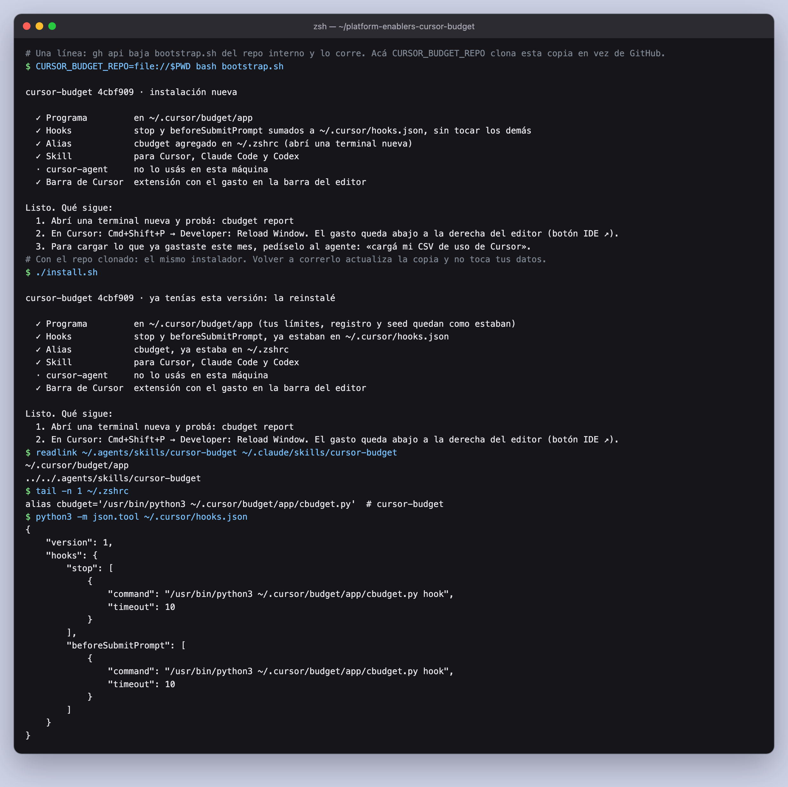
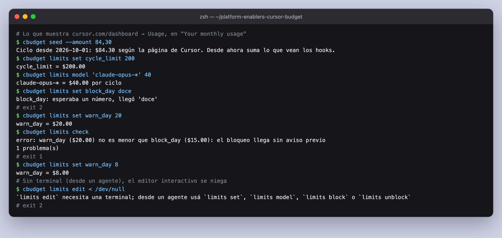
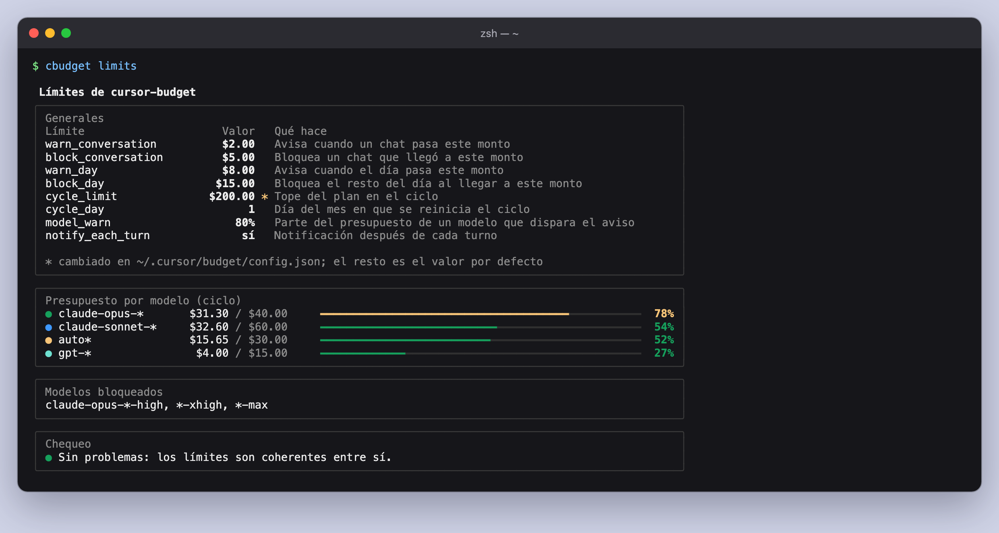
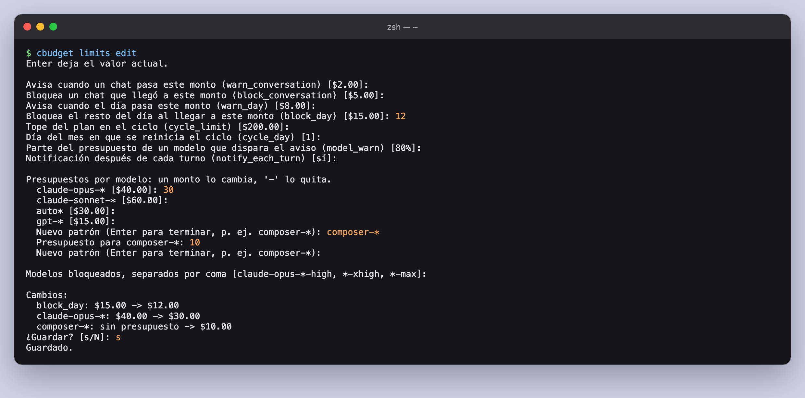
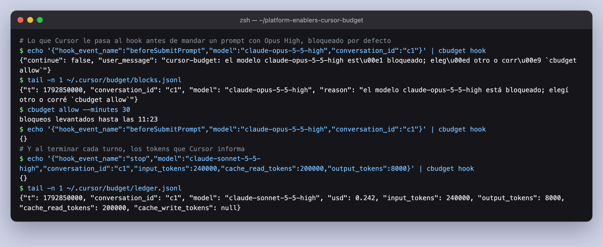

# Instalación detallada: comando por comando

Lo mismo que la [guía con prompts](instalacion.md), con los comandos y su salida. Cada opción está en la
[referencia](referencia.md).

## 1. Requisitos

- macOS o Linux. Los avisos son notificaciones del escritorio: `osascript` en macOS y `notify-send` en Linux (paquete
  `libnotify-bin` en Debian y Ubuntu, `libnotify` en Fedora y Arch). En Linux el alias va igual a `~/.zshrc`: si usás
  bash, copialo a tu `~/.bashrc`. En Windows no anda.
- Cursor con hooks (`~/.cursor/hooks.json`). Lo medido es de Cursor y `cursor-agent` 2026.10.22.
- El `python3` de macOS (`/usr/bin/python3`), que viene con las Command Line Tools; si falta,
  `xcode-select --install`. Los hooks corren con ese y no con uno de Homebrew, que desaparece con un `brew upgrade`.
- El comando `gh` instalado ([https://cli.github.com/](https://cli.github.com/), o `brew install gh`) y con la sesión iniciada (`gh auth login`), o acceso SSH a GitHub: el
  repo es interno y un `curl` sin autenticación recibe 404.

## 2. Instalar

Hay tres formas; las tres terminan corriendo el mismo `install.sh`.

**En una línea** (la recomendada; sirve también para actualizar):

```bash
gh api repos/josefigueredo/cursor-budget/contents/bootstrap.sh -H "Accept: application/vnd.github.raw" | bash
```

`gh api` baja `bootstrap.sh` con tu sesión de GitHub. El script clona el repo en una carpeta temporal (con `gh`, o por
SSH si `gh` no tiene sesión), corre `install.sh` y borra la carpeta.

**Con el repo clonado** (para desarrollar o revisar el código antes):

```bash
gh repo clone josefigueredo/cursor-budget && cd cursor-budget && ./install.sh
```

**Desde otra copia** (un fork, una rama o una ruta local): `CURSOR_BUDGET_REPO=<ruta o URL> bash bootstrap.sh`. Así se
hizo la captura de abajo, con esta misma copia del repo en lugar de GitHub:



`install.sh`:

1. Copia `cbudget.py`, `cbudget/` y `SKILL.md` a `~/.cursor/budget/app`. Los hooks usan esa copia, así siguen andando
   aunque el repo se mueva o cambie de rama.
2. Suma `cbudget hook` a los eventos `stop` y `beforeSubmitPrompt` de `~/.cursor/hooks.json`, sin tocar los demás hooks
   y con un `.bak` antes de cambiarlo. Si ya había una entrada de `cbudget` de otra carpeta, la apunta a la nueva.
3. Agrega `alias cbudget=...` a `~/.zshrc` (o `~/.bashrc`), una sola vez.
4. Enlaza la skill: `~/.agents/skills/cursor-budget` a la copia, y `~/.claude/skills` y `~/.codex/skills` a ese enlace.
5. Manda una notificación de prueba (en macOS y en Linux con `notify-send`; `CURSOR_BUDGET_NO_NOTIFY=1` la saltea).

El hook y el alias usan el `python3` con el que se instaló, con ruta absoluta, porque Cursor no siempre hereda el PATH
de la terminal: si cambiás de versión de Python, volvé a instalar. Volver a correrlo actualiza la copia y nunca toca
`config.json`, `ledger.jsonl`, `baseline.json` ni `changes.jsonl`. Después, reiniciá Cursor para que lea los hooks.

## 3. Comprobar las notificaciones

```bash
cbudget notify-test
```

Manda una notificación y explica qué hacer si no aparece: en macOS, Configuración del Sistema → Notificaciones → Script
Editor → «Permitir notificaciones»; en Linux, instalar `notify-send`. Ninguno de los dos le dice al programa si la
mostró, por eso la explicación sale siempre. Si `notify-send` falla (por ejemplo, sin sesión de escritorio), el motivo
queda en `~/.cursor/budget/notify-errors.log`.

## 4. Cargar el ciclo y fijar el tope



- `cbudget seed ~/Downloads/team-usage-events*.csv`, una sola vez: el CSV de cursor.com/dashboard/usage con **MTD** y
  **Export CSV**, con el detalle por modelo y por día. Sin CSV, `cbudget seed --amount 84,30` toma el monto de «Your
  monthly usage».
- `cbudget limits set cycle_limit 200`, si tu plan no es de $150.
- `cbudget extra`, cuando te otorgan el extra del plan: el tope del ciclo sube $75. Corrido otra vez registra el extra
  excepcional, otros $75. Los dos terminan con el ciclo.
- `cbudget limits model 'claude-opus-*' 40` le da a Opus un presupuesto del ciclo.
- Un valor que no es número sale con 2 y no cambia nada. `cbudget limits check` sale con 1 si los límites se
  contradicen; en la captura, un aviso diario más alto que el bloqueo.

## 5. Límites desde la terminal

`cbudget limits` muestra todo: los límites (con `*` los que cambiaste), el gasto de cada modelo contra su presupuesto,
los bloqueados y el chequeo.



`cbudget limits edit` pregunta uno por uno con el valor actual entre corchetes; Enter lo deja, un monto lo cambia y `-`
quita un presupuesto. Al final muestra los cambios y guarda solo si confirmás:



Sin una terminal (desde un agente) `limits edit` se niega con 2: ahí van `limits set`, `limits model`, `limits block` y
`limits unblock`.

## 6. El hook por dentro

Cursor le pasa cada evento por stdin y lee la respuesta por stdout. Se puede probar a mano:



`{"continue": false, ...}` es el bloqueo, y `{}` deja pasar. Cada bloqueo queda en `blocks.jsonl` y cada turno en
`ledger.jsonl` con su costo estimado. Si el hook falla por cualquier motivo contesta `{}`: nunca rompe Cursor.

## 7. Desinstalar

No hay desinstalador; son cuatro pasos:

1. En `~/.cursor/hooks.json`, borrá las dos entradas cuyo `command` termina en `cbudget.py hook`.
2. En `~/.zshrc` (o `~/.bashrc`), borrá la línea que termina en `# cursor-budget`.
3. Borrá los enlaces `~/.agents/skills/cursor-budget`, `~/.claude/skills/cursor-budget` y
   `~/.codex/skills/cursor-budget`.
4. Borrá `~/.cursor/budget/app`. El resto de `~/.cursor/budget/` es tu registro y tus límites: borralo solo si no los
   querés más.

## De dónde sale cada captura

| Imagen | Origen |
|---|---|
| `terminal-instalar.png`, `terminal-uso.png`, `terminal-hook.png` | **Salida real**: los guiones de `img/src/terminal-*.txt` corridos con `hdoc term` contra un `HOME` descartable, sin notificaciones y con las rutas acortadas a `~`. `bootstrap.sh` clona esta copia del repo con `CURSOR_BUDGET_REPO` en lugar de GitHub |
| `terminal-limites.png`, `terminal-report.png` | **Salida real** del `cbudget` actual, en color, sobre un ciclo de datos inventados que arma `img/src/gen_mocks.py` |
| `terminal-editar.png` | **Salida real** de `limits edit` sobre el mismo ciclo inventado, con respuestas guionadas que se muestran después de cada pregunta |

`img/src/capturas.sh` rehace todas.
