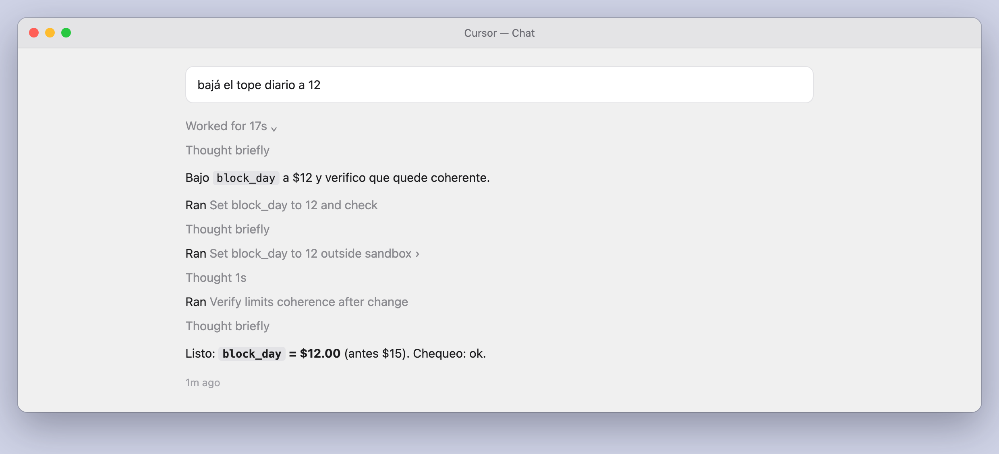

# Instalación y primer uso, conversando con tu agente

Todo se hace pidiéndoselo al agente: el chat de Cursor, Claude Code o Codex. Si preferís los comandos, está la
[instalación detallada](instalacion-detallada.md); para ver cada caso entero, el [showcase](showcase.md).

## 1. Instalar

Hace falta [gh](https://cli.github.com) con tu sesión de GitHub iniciada: el repo es interno. Si no lo tenés, pedile
primero al agente *«Instalá gh con brew y decime cómo iniciar sesión»*; el inicio de sesión (`gh auth login`) lo
hacés vos en una terminal, porque abre el navegador.

Después decile:

> *«Instalá cursor-budget: corré `gh api repos/josefigueredo/cursor-budget/contents/bootstrap.sh -H "Accept: application/vnd.github.raw" | bash`»*

El agente baja el instalador del repo y lo corre. Copia el programa a `~/.cursor/budget/app`, suma los dos hooks a
`~/.cursor/hooks.json` sin tocar los que ya tenías, agrega el alias `cbudget` a tu `~/.zshrc` y deja la skill a mano de
Cursor, Claude Code y Codex. Desde Cursor, el agente puede pedirte permiso para correrlo fuera del sandbox, porque
escribe en tu carpeta personal: aceptalo.

Para que los hooks y la skill se carguen, **cerrá Cursor y abrilo de nuevo** (o abrí un chat nuevo).

Si ya tenés el repo clonado, también sirve: *«Instalá cursor-budget desde ~/ruta/al/repo con ./install.sh»*.

## 2. Comprobar las notificaciones

Los avisos llegan como notificaciones de macOS. Al terminar, el instalador manda una de prueba: *«Prueba: así se ven los
avisos de gasto de Cursor.»* Si no la viste, macOS las tiene bloqueadas: abrí Configuración del Sistema →
Notificaciones → Script Editor y activá «Permitir notificaciones». Para probar de nuevo:

> *«Mandame una notificación de prueba de cursor-budget»*

## 3. Cargar lo que ya gastaste

El hook cuenta desde que lo instalaste: no sabe lo que gastaste antes en el ciclo. Abrí cursor.com/dashboard → Usage,
mirá «Your monthly usage» (por ejemplo «$84.30 / $200») y decile:

> *«Cursor dice que llevo 84,30 de 200 este mes»*

El agente carga lo gastado (`seed --amount`) y ajusta el tope del plan si no es el que trae por defecto ($225). Si
exportaste el CSV de uso (Usage → Export), pasáselo en lugar del monto: trae además el detalle por modelo y por día.

## 4. Preguntar cuánto llevás

> *«¿Cuánto llevo gastado en Cursor y cómo están mis límites?»*

*Maqueta reconstruida de un chat real de Cursor del 2026-10-24, con los números del ciclo de ejemplo.*

Para el reporte completo, con el gasto por día y los últimos turnos, en una terminal: `cbudget report` (es el ejemplo del
[README](../README.md#un-ejemplo-el-reporte)).

## 5. Cambiar un límite

Pedí el cambio con el valor que querés:

> *«Bajá el tope diario a 12»*

> *«Poné un presupuesto de 40 dólares para Opus en este ciclo»*

> *«Bloqueá GPT»*

*Maqueta reconstruida de un chat real de Cursor del 2026-10-24; el texto es el mismo.*

El agente cambia ese límite, revisa que los límites sigan siendo coherentes y te dice el valor de antes y el nuevo. Te
llega una notificación con cada cambio, aunque lo haya hecho el agente.

## 6. Cuando te frena

Si un prompt usa un modelo bloqueado (por defecto, Opus High y todo lo `xhigh` o `max`), o un chat, el día o el
presupuesto de un modelo llegaron a su tope, Cursor muestra «Submission blocked by hook» con el motivo, y el prompt no se
manda.

*Maqueta: el texto del aviso es el medido en el IDE el 2026-10-24; el diseño de la pantalla es aproximado.*

Lo que podés hacer, según el motivo:

- **Modelo bloqueado o sin presupuesto:** elegí otro modelo en el selector.
- **Chat caro:** abrí un chat nuevo; el contexto largo es lo que más encarece cada turno.
- **Si de verdad hace falta seguir:** en otro chat, *«Levantá el bloqueo media hora»*.

## 7. Actualizar

> *«Actualizá cursor-budget»*

Es la misma línea de instalación. Reemplaza el programa y respeta tus límites, tu registro y lo cargado del ciclo.

## Si algo falla

| Situación | Qué hacer |
|---|---|
| `gh: command not found`, o «Hace falta gh con la sesión iniciada» | Instalá gh (`brew install gh`) e iniciá sesión con `gh auth login` en una terminal |
| 404 al bajar el instalador | Tu cuenta de GitHub no ve el repo interno: pedí acceso a la organización |
| No llega ninguna notificación | Configuración del Sistema → Notificaciones → Script Editor → «Permitir notificaciones», y *«Mandame una notificación de prueba de cursor-budget»* |
| Cursor no frena ni avisa | Cerrá Cursor y abrilo de nuevo: los hooks se leen al arrancar |
| El agente no encuentra la skill | Abrí un chat nuevo; si sigue sin verla, reiniciá Cursor |
| El agente pide correr el comando fuera del sandbox | Es esperable: los límites viven en `~/.cursor/budget`. Aceptalo |
| El total no coincide con Cursor | Volvé a cargar el monto de la página de uso (paso 3): el hook estima, Cursor cobra |
| `cbudget: command not found` en la terminal | Abrí una terminal nueva: el alias se carga al abrirla |

## De dónde sale cada captura

| Imagen | Origen |
|---|---|
| `cursor-gasto.png`, `cursor-tope.png` | **Maqueta** reconstruida de chats reales de Cursor del 2026-10-24; en `cursor-gasto` se cambiaron los montos por los del ciclo de ejemplo y se acortaron los próximos pasos |
| `cursor-bloqueo.png` | **Maqueta**: el título y el mensaje son los que mostró el IDE de Cursor el 2026-10-24; el resto de la pantalla es aproximado |
| `terminal-report.png` (en el README) | **Salida real** del `cbudget` actual, con un ciclo de datos inventados |

Las fuentes están en [`img/src/`](img/src/): `gen_mocks.py` arma las maquetas y el reporte, y `capturas.sh` rehace todo.
