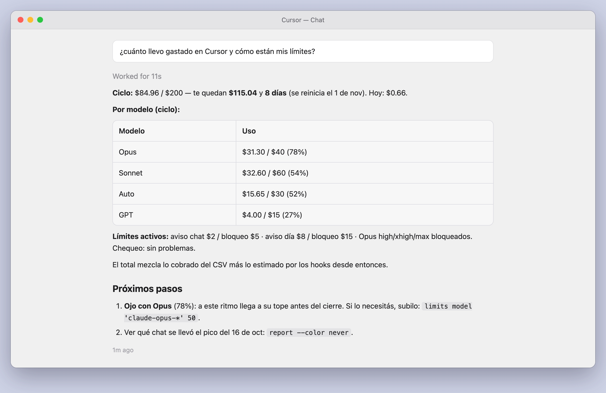
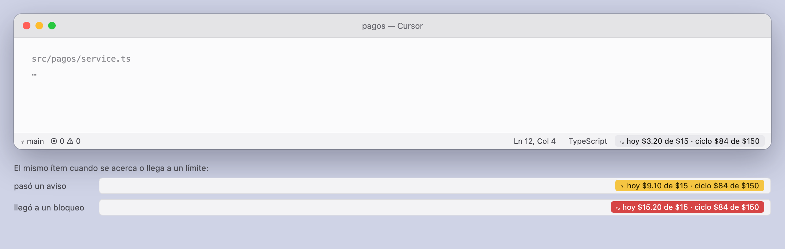
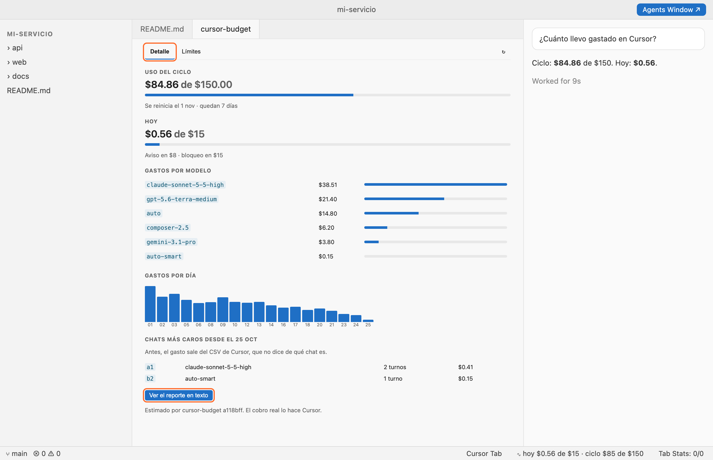
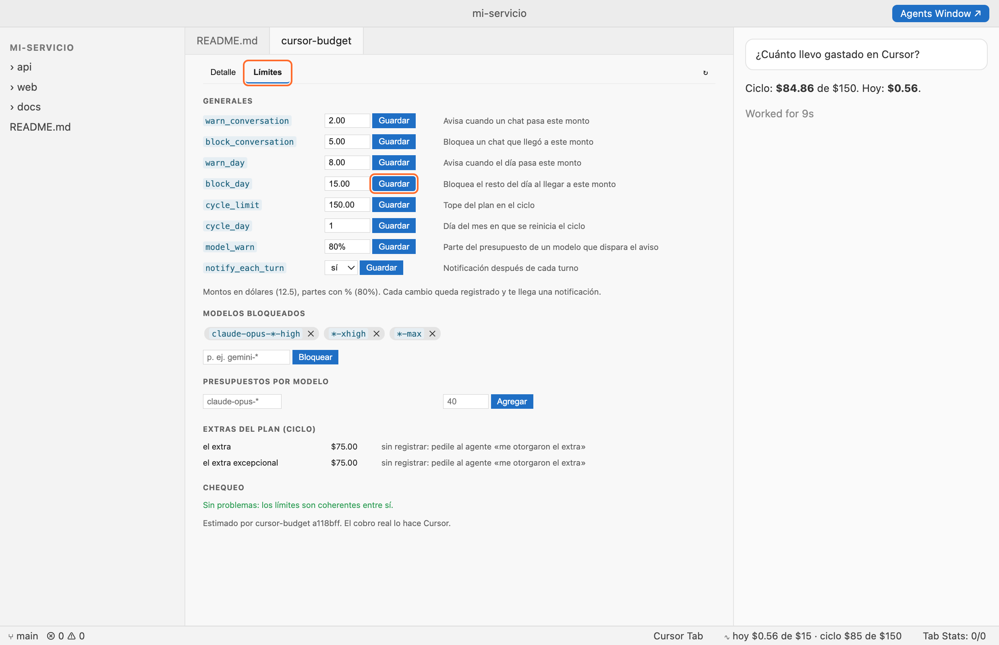
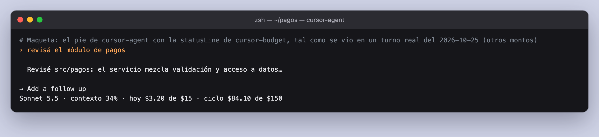
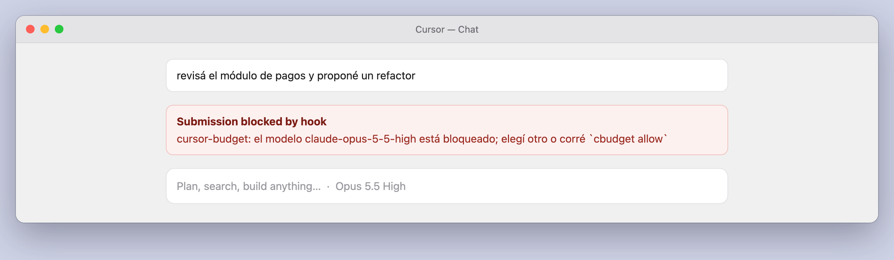

# Instalación y primer uso, conversando con tu agente

Todo se hace pidiéndoselo al agente: el chat de Cursor, Claude Code o Codex. Si preferís los comandos, está la
[instalación detallada](instalacion-detallada.md); para ver cada caso entero, el [showcase](showcase.md).

## 1. Instalar

Hace falta el comando `gh` (el CLI de GitHub) instalado en tu máquina y con tu sesión de GitHub iniciada: el repo es
interno. Si no lo tenés, se instala desde [https://cli.github.com/](https://cli.github.com/) (en macOS también podés
pedirle al agente *«Instalá gh con brew y decime cómo iniciar sesión»*). El inicio de sesión (`gh auth login`) lo
hacés vos en una terminal, porque abre el navegador.

Después decile:

> *«Instalá cursor-budget: corré `gh api repos/josefigueredo/cursor-budget/contents/bootstrap.sh -H "Accept: application/vnd.github.raw" | bash`»*

El agente baja el instalador del repo y lo corre. Copia el programa a `~/.cursor/budget/app`, suma los dos hooks a
`~/.cursor/hooks.json` sin tocar los que ya tenías, agrega el alias `cbudget` a tu `~/.zshrc` y deja la skill a mano de
Cursor, Claude Code y Codex. También instala una extensión chica en Cursor para ver el gasto en la barra de estado del editor, y
pone el gasto en el pie de cursor-agent si lo usás (paso 5). Desde Cursor, el agente puede pedirte permiso para correrlo
fuera del sandbox, porque escribe en tu carpeta personal: aceptalo.

Para que los hooks, la skill y la extensión se carguen, **cerrá Cursor y abrilo de nuevo**.

Si ya tenés el repo clonado, también sirve: *«Instalá cursor-budget desde ~/ruta/al/repo con ./install.sh»*.

## 2. Comprobar las notificaciones

Los avisos llegan como notificaciones del escritorio. Al terminar, el instalador manda una de prueba: *«Prueba: así se
ven los avisos de gasto de Cursor.»* Si no la viste, en macOS están bloqueadas: abrí Configuración del Sistema →
Notificaciones → Script Editor y activá «Permitir notificaciones». En Linux salen con `notify-send`: si no lo tenés, el
instalador te dice qué paquete instalar. Para probar de nuevo:

> *«Mandame una notificación de prueba de cursor-budget»*

## 3. Cargar lo que ya gastaste

**Una sola vez, el día que lo instalás.** El hook cuenta desde que lo instalaste y no sabe lo que gastaste antes este
mes, así que se lo pasás desde la página de uso de Cursor:

1. Abrí [cursor.com/dashboard/usage](https://cursor.com/dashboard/usage) en el navegador, con tu cuenta de Cursor.
2. Arriba del gráfico, tocá **MTD** (el mes en curso, del día 1 a hoy) y después **Apply**.
3. Tocá **Export CSV**. Se baja un archivo a **Descargas** con un nombre que empieza con `team-usage-events`.

Después, en el chat de Cursor, pasale ese archivo en el primer prompt:

> *«Es la primera vez que uso cursor-budget. Cargá el CSV de uso que bajé de Cursor: ~/Downloads/team-usage-events….csv»*

Si no sabés la ruta, arrastrá el archivo desde Descargas al chat. El agente corre `seed` con el CSV y te dice cuánto
llevás, con el detalle por modelo y por día. **No hay que repetirlo:** desde ahí los hooks cuentan cada turno, también
en los meses que vienen. Si elegiste más días de los del mes, no pasa nada: lo de antes del día 1 se ignora.

Sin CSV también se puede: decile el monto de «Your monthly usage» (*«Cursor dice que llevo 84,30 este mes»*) y lo carga
con `seed --amount`, sin el detalle por modelo.

Si pasás el tope y te otorgan el extra del plan, decile *«me otorgaron el extra»*: el tope del ciclo sube $75. Si
después te dan el extra excepcional, otros $75. El aviso del 100% te recuerda cuál podés pedir.

## 4. Preguntar cuánto llevás

> *«¿Cuánto llevo gastado en Cursor y cómo están mis límites?»*

*Maqueta reconstruida de un chat real de Cursor del 2026-10-24, con los números del ciclo de ejemplo.*

Para el reporte completo, con el gasto por día y los últimos turnos, en una terminal: `cbudget report` (es el ejemplo del
[README](../README.md#un-ejemplo-el-reporte)).

## 5. Ver el gasto mientras trabajás

No hace falta preguntar: el gasto está siempre a la vista.

**En el editor de Cursor**, abajo a la derecha, en la barra de estado. Cursor 3 abre la ventana de Agentes, que no
tiene barra de estado: para ver el gasto ahí, tocá **IDE ↗** (arriba a la derecha) y se abre el editor. En la ventana
de Agentes el gasto te llega igual en la notificación de cada turno, y se lo podés preguntar al agente (paso 4).

*Maqueta: la ventana es aproximada; el texto y los colores son los que pone la extensión.*

- **hoy** es lo que gastaste en el día, al lado del tope diario (`block_day`).
- **ciclo** es lo que llevás del mes de facturación, al lado del tope del plan más los extras que te otorgaron.
- Se pone **amarilla** cuando pasás un aviso (el del día, o el 75% del ciclo) y **roja** cuando llegás a un bloqueo o
  al tope del ciclo.
- Un clic abre un panel con dos pestañas: **Detalle** (el ciclo, hoy, el gasto por modelo, por día y los chats más
  caros) y **Límites**, donde cambiás cada límite, bloqueás o desbloqueás modelos y ponés presupuestos por modelo.
  Cada cambio queda registrado y te llega la notificación, igual que si se lo pedís al agente.

*Maquetas: la ventana es aproximada; el panel es el que dibuja la extensión, con los datos del ciclo de ejemplo.*

**En cursor-agent** (Cursor en la terminal), el pie muestra el modelo, cuánto del contexto usaste y el mismo gasto:

*Maqueta del pie que se vio en un turno real de cursor-agent del 2026-10-25, con otros montos.*

Si ya tenías tu propio pie en cursor-agent, el instalador no lo toca.

## 6. Cambiar un límite

Pedí el cambio con el valor que querés:

> *«Bajá el tope diario a 12»*

> *«Poné un presupuesto de 40 dólares para Opus en este ciclo»*

> *«Bloqueá GPT»*

*Maqueta reconstruida de un chat real de Cursor del 2026-10-24; el texto es el mismo.*

El agente cambia ese límite, revisa que los límites sigan siendo coherentes y te dice el valor de antes y el nuevo. Te
llega una notificación con cada cambio, aunque lo haya hecho el agente.

## 7. Cuando te frena

Si un prompt usa un modelo bloqueado (por defecto, Opus High y todo lo `xhigh` o `max`), o un chat, el día o el
presupuesto de un modelo llegaron a su tope, Cursor muestra «Submission blocked by hook» con el motivo, y el prompt no se
manda.

*Maqueta: el texto del aviso es el medido en el IDE el 2026-10-24; el diseño de la pantalla es aproximado.*

Lo que podés hacer, según el motivo:

- **Modelo bloqueado o sin presupuesto:** elegí otro modelo en el selector.
- **Chat caro:** abrí un chat nuevo; el contexto largo es lo que más encarece cada turno.
- **Si de verdad hace falta seguir:** en otro chat, *«Levantá el bloqueo media hora»*.

## 8. Actualizar

Cuando sale una versión nueva te llega una notificación: *«Hay una versión nueva de cursor-budget…»*. Se fija una vez
por día y avisa una sola vez por versión. Para actualizar:

> *«Actualizá cursor-budget»*

Reemplaza el programa y respeta tus límites, tu registro y lo cargado del ciclo. Después recargá Cursor para que tome
la extensión nueva. Si instalaste antes de que existiera el aviso, actualizá una vez a mano: desde ahí, te avisa solo.

## Si algo falla

| Situación | Qué hacer |
|---|---|
| `gh: command not found`, o «Hace falta gh con la sesión iniciada» | Instalá gh desde https://cli.github.com/ (o `brew install gh`) e iniciá sesión con `gh auth login` en una terminal |
| 404 al bajar el instalador | Tu cuenta de GitHub no ve el repo interno: pedí acceso a la organización |
| No llega ninguna notificación | En macOS, Configuración del Sistema → Notificaciones → Script Editor → «Permitir notificaciones»; en Linux, instalá `notify-send` y mirá `~/.cursor/budget/notify-errors.log`. Después, *«Mandame una notificación de prueba de cursor-budget»* |
| Cursor no frena ni avisa | Cerrá Cursor y abrilo de nuevo: los hooks se leen al arrancar |
| El agente no encuentra la skill | Abrí un chat nuevo; si sigue sin verla, reiniciá Cursor |
| El agente pide correr el comando fuera del sandbox | Es esperable: los límites viven en `~/.cursor/budget`. Aceptalo |
| El total no coincide con Cursor | Volvé a cargar el monto de la página de uso (paso 3): el hook estima, Cursor cobra |
| `cbudget: command not found` en la terminal | Abrí una terminal nueva: el alias se carga al abrirla |
| No veo el gasto en la barra de estado de Cursor | Si estás en la ventana de Agentes (sin barra abajo), la barra está en el editor: tocá **IDE ↗**. Si ya estás en el editor, recargá la ventana: paleta de comandos (Cmd+Shift+P) → **Developer: Reload Window**. Cursor carga una extensión nueva recién al recargar |
| La instalación dice que no pudo instalar la extensión | Tu organización puede permitir solo extensiones aprobadas. Pedí que la aprueben, o instalala vos: paleta de comandos → **Extensions: Install from VSIX…** y elegí el archivo que te nombra el instalador |
| El pie de cursor-agent no muestra el gasto | Cerrá cursor-agent y abrilo de nuevo. Si sigue igual, *«Poné el gasto en el pie de cursor-agent»* |
| La instalación dice «no lo toqué» | Tu `~/.cursor/hooks.json` no es JSON válido (te dice la línea): arreglalo o pedile al agente que lo revise, y volvé a instalar |

## De dónde sale cada captura

| Imagen | Origen |
|---|---|
| `cursor-gasto.png`, `cursor-tope.png` | **Maqueta** reconstruida de chats reales de Cursor del 2026-10-24; en `cursor-gasto` se cambiaron los montos por los del ciclo de ejemplo y se acortaron los próximos pasos |
| `cursor-bloqueo.png` | **Maqueta**: el título y el mensaje son los que mostró el IDE de Cursor el 2026-10-24; el resto de la pantalla es aproximado |
| `cursor-barra.png` | **Maqueta**: la ventana es aproximada; el texto y los colores son los de la extensión (`vscode/format.js`) |
| `cursor-panel-detalle.png`, `cursor-panel-limites.png` | **Maqueta**: la ventana imita el editor de Cursor 3.22; el panel lo dibuja `vscode/panel.js` con los datos inventados del episodio. Son las mismas páginas del episodio 09 |
| `agent-pie.png` | **Maqueta** del pie que mostró cursor-agent 2026.10.22 en un turno real del 2026-10-25, con otros montos |
| `terminal-report.png` (en el README) | **Salida real** del `cbudget` actual, con un ciclo de datos inventados |

Las fuentes están en [`img/src/`](img/src/): `gen_mocks.py` arma las maquetas y el reporte, y `capturas.sh` rehace todo.
