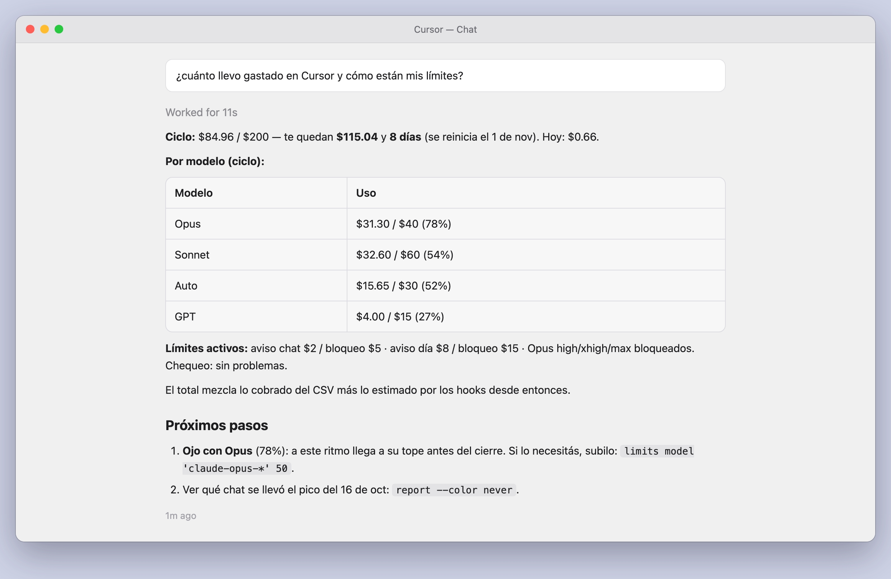
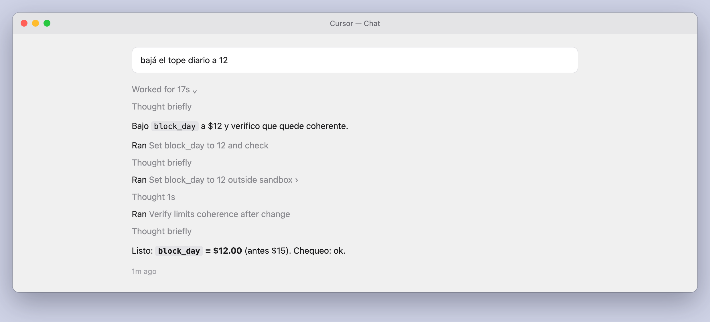
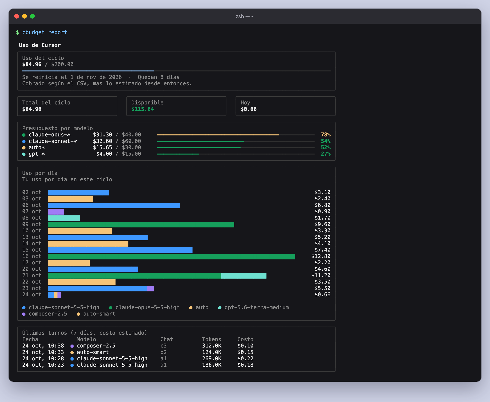
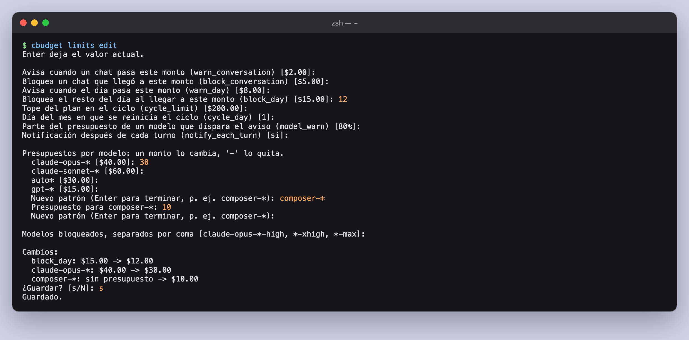
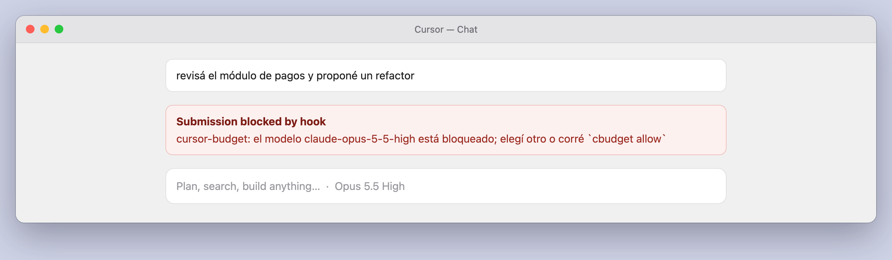
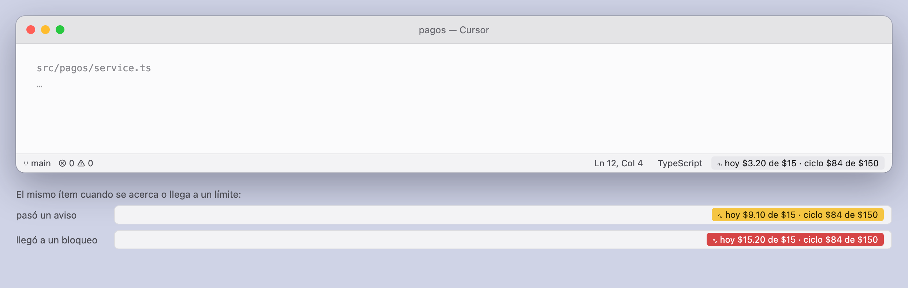
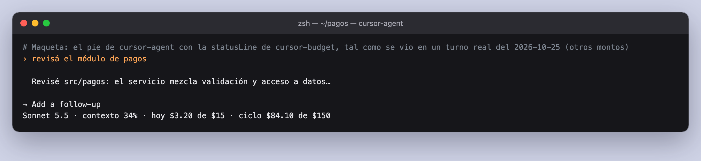

# Showcase

Qué se puede hacer con `cursor-budget`, caso por caso: qué le decís al agente, qué corre por detrás y qué ves. Para
instalarlo, la [guía con prompts](instalacion.md) o la [detallada](instalacion-detallada.md); cada opción, en la
[referencia](referencia.md).

| Componente | Escenario | Ir al caso |
|---|---|---|
| skill + hook `stop` | «¿Cuánto llevo gastado en Cursor?» | [Ver cuánto llevás](#1-ver-cuánto-llevás) |
| skill | «Bajá el tope diario a 12» | [Cambiar un límite desde el chat](#2-cambiar-un-límite-desde-el-chat) |
| `cbudget` | `cbudget report`, `cbudget limits edit` | [El reporte y el editor](#3-el-reporte-y-el-editor-en-la-terminal) |
| hook `beforeSubmitPrompt` | Mandás un prompt con Opus High | [Cuando te frena](#4-cuando-te-frena) |
| hook `stop` | Un chat se pone caro | [Los avisos](#5-los-avisos) |

---

## Lo que lo distingue

| | La página de uso de Cursor | cursor-budget |
|---|---|---|
| ¿Cuándo te enterás? | Cuando entrás a mirarla | En cada turno, con una notificación |
| ¿Frena algo? | Solo el tope del plan, que pone un administrador | Tus propios topes por chat, por día y por modelo, antes de mandar el prompt |
| ¿Cuánto costó este chat? | No lo muestra por chat | Sí: el costo estimado de cada turno y de cada chat |
| ¿Es exacto? | Sí: es lo que cobra | Estimado: ±5% contra la factura en lo medido |
| ¿Lo cambiás desde el chat? | No | Sí, con la skill; cada cambio te llega como notificación |

**Usá cursor-budget** para enterarte mientras trabajás y frenarte antes de un gasto que no querías: un modelo caro
elegido sin querer, un chat que arrastra un contexto enorme. **Mirá la página de Cursor** para el número que vas a
pagar: cursor-budget lo estima, Cursor lo cobra.

---

## 1. Ver cuánto llevás

**Componente:** skill y hook `stop` · **Escribe:** nada.

*Maqueta reconstruida de un chat real de Cursor (2026-10-24), con los números del ciclo de ejemplo.*

| # | Paso | Comando |
|---|---|---|
| 1 | Lee el ciclo, lo disponible, el gasto de hoy, el de cada modelo y los últimos turnos | `cbudget report --color never` |
| 2 | Lee los límites y el chequeo de coherencia | `cbudget limits --color never` |
| 3 | Te contesta con los números que importan, no con la pantalla entera | — |

El total del ciclo es lo que cargaste con `seed` (lo que decía Cursor) más lo que el hook estimó desde entonces. Si no
cargaste nada, el agente te avisa que cuenta solo desde la instalación y te pide el monto de la página de uso.

**Qué pasa si algo sale mal**

| Situación | Resultado |
|---|---|
| Nunca cargaste lo gastado | El total arranca el día que instalaste; el agente te pide el monto de cursor.com/dashboard → Usage |
| El total no coincide con Cursor | Es una estimación; volvé a cargar el monto y el ciclo se alinea |

## 2. Cambiar un límite desde el chat

**Componente:** skill · **Escribe:** `~/.cursor/budget/config.json` y `changes.jsonl`.

*Maqueta reconstruida de un chat real de Cursor (2026-10-24); el texto es el mismo.*

| # | Paso | Comando |
|---|---|---|
| 1 | Cambia solo lo que pediste, con tu valor | `cbudget limits set block_day 12` |
| 2 | Desde Cursor, pide correrlo fuera del sandbox: escribe en `~/.cursor/budget` | — |
| 3 | Revisa que los límites sigan siendo coherentes | `cbudget limits check` |
| 4 | Te dice el valor anterior, el nuevo y el resultado del chequeo | — |

Otros pedidos: un presupuesto por modelo (`limits model 'claude-opus-*' 40`), quitarlo (`--remove`), bloquear o
desbloquear un patrón (`limits block` / `limits unblock`), levantar los bloqueos un rato (`allow --minutes 30`).

**Qué pasa si algo sale mal**

| Situación | Resultado |
|---|---|
| El valor no es un número | `cbudget` sale con 2, no cambia nada y el agente te dice por qué |
| El cambio deja los límites contradictorios | `limits check` sale con 1 y el agente te muestra el problema; el cambio ya quedó, así que te propone corregirlo |
| Un bloqueo le corta la tarea al agente | No se lo levanta solo: te dice qué lo frenó y vos decidís |

## 3. El reporte y el editor en la terminal

**Componente:** `cbudget` · **Escribe:** `config.json` y `changes.jsonl`, solo si confirmás en el editor.

*Salida real del `cbudget` actual, con un ciclo de datos inventados.*

`cbudget report` sigue el diseño de la página de uso de Cursor: el ciclo y cuándo se reinicia, total, disponible y hoy,
la barra de cada presupuesto por modelo (verde, ámbar desde el 75%, rojo desde el 90%), el gasto por día del ciclo
apilado por modelo y los últimos turnos con su chat. Respeta `NO_COLOR` y, fuera de una terminal, sale sin color.

`cbudget limits edit` es lo mismo que la skill, para quien prefiere la terminal: pregunta límite por límite y guarda
solo si confirmás.

*Salida real de `limits edit` con respuestas guionadas, que se ven después de cada pregunta.*

## 4. Cuando te frena

**Componente:** hook `beforeSubmitPrompt` · **Escribe:** `~/.cursor/budget/blocks.jsonl`.

*Maqueta: el texto del aviso es el medido en el IDE de Cursor (2026-10-24); el diseño de la pantalla es aproximado.*

Antes de mandar cada prompt, Cursor le pregunta al hook. El hook frena, en este orden:

1. Un modelo de `blocked_models` (por defecto `claude-opus-*-high`, `*-xhigh` y `*-max`).
2. Un modelo cuyo presupuesto del ciclo se agotó.
3. Un chat que llegó a `block_conversation` ($5).
4. Un día que llegó a `block_day` ($15).

El prompt no llega al modelo y no cuesta nada. Además sale una notificación, porque `cursor-agent` en la terminal no
muestra el mensaje. `cbudget allow --minutes 30` levanta todos los bloqueos un rato.

**Qué pasa si algo sale mal**

| Situación | Resultado |
|---|---|
| El hook falla (Python roto, archivo ilegible) | Deja pasar el prompt: un freno roto no puede romper Cursor |
| Cursor no muestra el mensaje | El bloqueo igual queda en `blocks.jsonl` y en la notificación |

## 5. Los avisos

**Componente:** hook `stop` · **Escribe:** `~/.cursor/budget/ledger.jsonl`.

Después de cada turno, una notificación con el costo del turno, del chat y del ciclo (`notify_each_turn`; se apaga con
*«Apagá la notificación de cada turno»*). Además, una sola vez cada uno:

- cuando el chat pasa `warn_conversation` ($2): *«abrí un chat nuevo»*;
- cuando el día pasa `warn_day` ($8);
- cuando el ciclo cruza 75%, 90% y 100% de `cycle_limit`;
- cuando un modelo usa el 80% (`model_warn`) y el 100% de su presupuesto;
- cuando sale una versión nueva de cursor-budget (se fija una vez por día; avisa una vez por versión).

## 6. El gasto siempre a la vista

**Componentes:** la extensión de Cursor (`vscode/`) y la `statusLine` de cursor-agent · **Escribe:** nada; leen el
registro.

*Maqueta: la ventana es aproximada; el texto y los colores son los de la extensión.*

La app de Cursor no deja que un hook escriba en el chat, así que el gasto va en la barra de estado del editor (en
Cursor 3, el botón **IDE ↗**; la ventana de Agentes no tiene barra de estado): lo de hoy contra
`block_day` y lo del ciclo contra el tope con sus extras. Amarillo al pasar un aviso, rojo al llegar a un bloqueo. Un
clic abre un panel con el detalle (ciclo, hoy, por modelo, por día, los chats más caros) y otra pestaña para cambiar
los límites, que pasan por `cbudget limits` como desde el chat. En cursor-agent, el mismo gasto ocupa el pie, junto al modelo y al contexto:

*Maqueta del pie que mostró cursor-agent en un turno real del 2026-10-25, con otros montos.*

**Qué pasa si algo sale mal**

| Situación | Resultado |
|---|---|
| Trabajás en la ventana de Agentes de Cursor 3 | No hay barra de estado ahí: el gasto se ve en el editor (**IDE ↗**), en la notificación de cada turno o preguntándole al agente |
| La extensión recién instalada no aparece | Cursor la carga al recargar la ventana (**Developer: Reload Window**) |
| La organización solo permite extensiones aprobadas | La instalación sigue; la extensión se instala a mano desde el `.vsix` o cuando la aprueben |
| Faltan las Command Line Tools | La barra dice «cursor-budget sin instalar» y no abre el diálogo de macOS en cada consulta |
| cursor-agent ya tenía su propio pie | El instalador no lo reemplaza |

---

## Qué te protege y qué no

**Te protege:**

- Un modelo caro elegido sin querer: Opus High, `xhigh` y `max` vienen bloqueados.
- Un chat que arrastra un contexto enorme: lo más caro no suele ser el modelo, sino el contexto que se reenvía en cada
  turno. El aviso a los $2 y el bloqueo a los $5 por chat apuntan a eso.
- Un agente que se sube su propio presupuesto: la skill solo cambia lo que pediste, y cada cambio queda en
  `changes.jsonl` con quién lo hizo y te llega como notificación.

**No te protege:**

- **No es seguridad.** Quien usa la máquina puede editar `config.json` o correr `allow`. Es un freno para uno mismo.
- **Es una estimación.** El hook calcula con precios de lista y los tokens que informa Cursor; el número que se paga es
  el de Cursor.
- **Auto es aproximado.** El hook ve `auto-smart`, no el modelo al que Auto derivó, y lo cobra a precio de Sonnet 5.5.
- **No ve otras máquinas ni otros usuarios.** Cada instalación cuenta lo suyo.
- **Si el hook falla, deja pasar.** Preferimos un turno sin contar a un Cursor que no responde.
